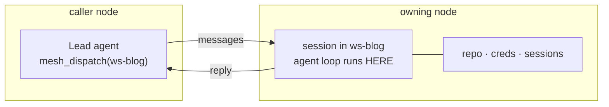

# dsh-workspace-mesh

[](https://www.npmjs.com/package/dsh-workspace-mesh)
[](https://github.com/ChenXu233/dsh-workspace-mesh/actions/workflows/ci.yml)
[](./LICENSE)

**English** · [中文](./README.zh-CN.md)

Workspace **mesh** for [DeepSeek Harness](https://github.com/deepseek-ai/deepseek-harness) — a grid of
*workspaces*, not of agents.

> **Not resource remote-access.** The agent loop never leaves the machine that owns the workspace.
> Peers exchange messages only: no remote shell, no remote file API — by design
> ([SPEC.md](./SPEC.md) §8, §16.6).

## Why

You run more than one DSH instance: a laptop, a staging box, a cloud host. Work does not spread
evenly over them — a workspace *belongs* to one machine, and the repository, the credentials and the
long-running sessions live there.

Proxying a conversation to that machine already works, and it has the right shape: the agent loop
stays where the files are. What is missing is the other direction — **one Lead that dispatches work
by workspace, to the machine that owns it, and reads the result back**, without knowing which box
is which.



## What it does

| | |
| --- | --- |
| **Declares placement** | `assignment.yml` maps `workspaceId → nodeId`, plus the remote `cwd` a new session owns. Static by design — no discovery, no hub process. |
| **Dispatches by workspace** | `mesh_dispatch` creates a session on the owning machine, sends the objective, and blocks until the final reply (or `dispatchTimeoutMs`). |
| **Reports, never guesses** | `mesh_list_nodes` merges the assignment table with transport receipts. A peer without a receipt is `unknown` — never `online`. |
| **Stays out of execution** | Across the machine boundary only `session/*` and `workspace/*` calls travel. |
| **Degrades, does not crash** | No peers? The plugin still loads; `mesh_dispatch` reports `unavailable` and the other three tools keep working. |
| **Zero runtime dependencies** | Plain JSON Schema tool definitions; cordis services are probed at runtime instead of imported from the host (SPEC §9.4). |
| **Optionally composes with 质子** | When `dsh-proton-workspace` is mounted, the browser half registers this mesh as one workspace source (`ctx.protonWorkspace.addSource`), so the shipped add-workspace flow can pick a remote workspace. Absent proton the injection never resolves and nothing else changes. |

## Requirements

| | |
| --- | --- |
| dsh | `>=0.2.1-rc.2` — declared in `dsh.engines`, checked when the bundle loads |
| Node.js | `>=20` |
| Runtime dependencies | none |
| Peers | a DSH instance serving its web UI (the transport calls `/connect` and `/api/...` there) |

## Install

```sh
dsh plugin --profile web add dsh-workspace-mesh
```

Or mount it from an overlay patch (`--patch`) without installing — `name` is a module specifier:

```yaml
- insert:
    - id: mesh
      name: dsh-workspace-mesh
```

The bundled [cordis.patch.yml](./cordis.patch.yml) ships empty on purpose: the entry belongs to the
deployer's profile patch, which keeps it uniquely addressed.

## Quick start

### 1. Install on every node you want to address

The caller needs the plugin for the tools and the transport. A peer needs it to publish its native
workspaces (`GET /api/mesh/workspaces`) and, in relay mode, to serve the handshake and relay routes.
A peer without it still works when every assignment carries a `cwd`: the transport then creates the
session in that directory.

### 2. Configure the peer

In the caller's profile patch:

```yaml
- insert:
    - id: mesh
      name: dsh-workspace-mesh
      config:
        peers:
          - nodeId: tencent
            baseUrl: https://dsh.example.com   # the peer's web root
            token: <login token>               # the ?token= value dsh web prints
        meshSecret: <shared secret>            # optional: relay mode, see Credentials
        assignmentFile: ./assignment.yml       # resolved against the host process cwd
```

### 3. Declare where the workspaces live

`assignment.yml` ([example](./examples/assignment.yml)):

```yaml
nodes:
  tencent: { label: cloud }

assignments:
  - { workspaceId: ws-blog, nodeId: tencent, cwd: /data/workspace/blog }
```

`cwd` is only needed when the peer does not publish that workspace id itself: dispatch uses the native
id when it can and falls back to the directory when it cannot.

### 4. Restart, look, dispatch

Restart the host so the entry is applied, then open Settings → **Workspace mesh** (or read
`GET /api/mesh/state`): `transport.kind` should read `typert`.

Ask the model for a dispatch, or call the tool yourself:

```json
{ "workspaceId": "ws-blog", "objective": "Run the test suite and summarise the failures." }
```

```json
{ "ok": true, "state": "done", "result": { "summary": "...", "sessionId": "..." } }
```

## Credentials

| Mode | Configure | After the peer restarts | Authority on the peer |
| --- | --- | --- | --- |
| login token (default) | `peers[].token` | the token rotates; update it by hand | the owner's full access |
| relay | `peers[].token` + the same `meshSecret` on both nodes | automatic re-handshake, nothing to update | a 10-minute mesh token, five session operations |

In relay mode the caller signs `mesh-handshake:<nodeId>:<ts>:<nonce>` with the shared secret and
trades it for a short-lived token, so nothing depends on the rotating login token. The handshake and
relay routes sit below the browser fence — the caller has no cookie yet — and verify that token
themselves.

Peers back off after two consecutive failures (60 s, doubling, capped at 16×) instead of hammering a
stale credential: a steady stream of 401s is exactly what a host intrusion filter bans this machine
for.

> **Keep the mesh on a trusted network.** The login token *is* the peer's owner session. Relay mode
> narrows that to five session operations, but neither mode replaces the credential layer in SPEC
> §17, which does not exist yet ([decisions.md](./docs/explanation/decisions.md) D13).

## Model tools

| Tool | What it does |
| --- | --- |
| `mesh_list_nodes` | Roster: the assignment table merged with transport receipts, filterable by `nodeId` / `workspaceId`. |
| `mesh_status` | Local snapshot — transport, assignment table, task board counts, lifecycle. Never calls the network. |
| `mesh_dispatch` | Dispatch a task and block for the reply. Returns `taskId`, `target`, `state`, `result` or an `error` code. |
| `mesh_task_status` | Read one task off the in-memory board (cleared when the process exits). |

Error codes: `unavailable`, `unknown-node`, `invalid-target`, `denied`, `node-offline`, `timeout`,
`remote-failure`. Parameters, output shapes and the `replyMode` caveat:
[docs/reference/tools.md](./docs/reference/tools.md).

## Settings page

The browser half registers four surfaces: a **Workspace mesh** section in Settings, a live
configuration card on the plugin's own page, a left-rail entry, and the workspace page that entry
opens — every reachable workspace, which machine owns it, whether that machine is online, a message
box for it, and a read-only view of a remote session's tail. Remote workspaces are virtual there:
nothing is copied, the loop still runs on the owning machine.

```text
browser routes   behind the host's signed-cookie fence
  GET  /api/mesh/state        read-only snapshot the page renders
  POST /api/mesh/config       validate + persist a config patch, apply the hot fields
  GET  /api/mesh/workspaces   this node's native workspaces, published to peers
  GET  /api/mesh/session      tail of a remote session
  POST /api/mesh/dispatch     dispatch from the page — the same code path as the tool

peer routes      below the fence, authenticated by the mesh token
  POST /api/mesh/handshake    HMAC → short-lived mesh token
  POST /api/mesh/relay        run one session operation on this node
```

Payloads, status codes and the hot/restart split:
[docs/reference/http-api.md](./docs/reference/http-api.md).

## Configuration

The entry config (`config:` in the profile patch) is layered under
`$DSH_HOME/mesh-config.json`, the file the settings page writes:

| Key | Type | Default | Applies |
| --- | --- | --- | --- |
| `transport` | `auto` | `auto` | restart |
| `peers` | `{ nodeId, baseUrl, token }[]` | `[]` | restart |
| `meshSecret` | string | `''` | restart |
| `assignmentFile` | string | `''` (not loaded) | immediately |
| `leaseMs` | integer, ms | `900000` | immediately |
| `dispatchTimeoutMs` | integer, ms | `120000` | immediately |
| `leaseOwner` | string | `mesh-lead` | immediately |

`leaseMs` must stay greater than `dispatchTimeoutMs`, otherwise dispatch refuses with `denied` — a
slow task must not be fenced by its own expired lease. Field semantics and the other invariants:
[docs/reference/config.md](./docs/reference/config.md).

## Status

Working, with tests: tool registration and argument validation, the in-memory board with
lease/fencing, roster derivation, `assignment.yml` parsing (errors carry file and line), config
layering and hot reload, the settings routes, the browser dispatch path, the Typert transport in both
credential modes (backoff on a failing peer, one replay for read-only calls), remote workspace and
session listing, and remote session history. The self-restart controller and the identity primitives
exist but are not wired to a request path.

Deliberately absent:

| | Why |
| --- | --- |
| `mesh_task_wait` / `mesh_cancel` | They need a persistent task board and a cancel channel; the board is in memory. |
| A `replyMode: "stream"` that advances on its own | Same reason: no background collector, so a stream dispatch returns `running` + `pending: true` and stays there. |
| `mesh_lifecycle`, `mesh_plugin_*`, grants (T1–T3) | They need the cross-machine planes in SPEC §14–§16 first. |
| A hub or broadcast registry | Placement is the static `assignment.yml` ([decisions.md](./docs/explanation/decisions.md) D3). |
| Remote shell or file access | Not implemented, and not planned (SPEC §16.6). |

## Development

```sh
pnpm install
pnpm build
dsh plugin --profile web add file:$(pwd)
```

`pnpm verify` is the CI gate: build, typecheck, the `node:test` suites and the docs check. After
touching `client/client.js`, run `node --check client/client.js` — a syntax error there keeps the
whole plugin from registering. The deployment chain the maintainers use (pack overlay,
`sync-plugin.ps1`) is described in [docs/how-to/development.md](./docs/how-to/development.md).

## Docs

[docs/README.md](./docs/README.md) is the only index. Design intent: [SPEC.md](./SPEC.md).
Chinese: [README.zh-CN.md](./README.zh-CN.md).

## Contributing

What a change has to look like — including the "code and docs disagree, decide which one is wrong"
rule — is in [CONTRIBUTING.md](./CONTRIBUTING.md); the agent-facing invariants are in
[AGENTS.md](./AGENTS.md).

## License

Apache License 2.0 — see [LICENSE](./LICENSE) and [NOTICE](./NOTICE). The reasoning behind the choice
is in [decisions.md](./docs/explanation/decisions.md) D11.
