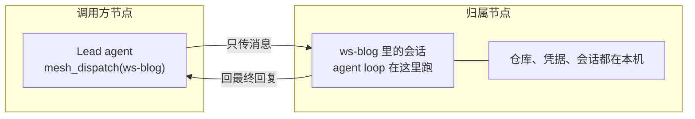

# dsh-workspace-mesh

[](https://www.npmjs.com/package/dsh-workspace-mesh)
[](https://github.com/ChenXu233/dsh-workspace-mesh/actions/workflows/ci.yml)
[](./LICENSE)

[English](./README.md) · **中文**

给 [DeepSeek Harness](https://github.com/deepseek-ai/deepseek-harness) 的工作区**网格**（mesh）：网格里排的是
*工作区*，不是 agent。

> **不是资源远程访问。** agent loop 永远不离开工作区所在的机器，跨机只传消息：没有远程 shell，也没有远程
> 文件接口，这是设计约束（[SPEC.md](./SPEC.md) §8、§16.6）。

## 为什么

你手上有不止一台 DSH：笔记本、测试机、云主机。工作不是均匀分布的——一个工作区只属于一台机器，仓库、凭据、
长跑会话都在那台机器上。

把对话代理到那台机器已经能用，方向也对：agent loop 留在文件所在的地方。缺的是反方向——**让一个 Lead 按工作区
把任务投递到归属它的机器，并拿回结果**，而不用先搞清楚哪台是哪台。



## 它做什么

| | |
| --- | --- |
| **声明归属** | `assignment.yml` 把 `workspaceId → nodeId` 写死，附带远端会话要占用的 `cwd`。静态分配是刻意的——没有自动发现，也没有 hub 进程。 |
| **按工作区投递** | `mesh_dispatch` 在归属机上建会话、发目标，然后阻塞到最终回复（或 `dispatchTimeoutMs` 超时）。 |
| **只报告，不猜** | `mesh_list_nodes` 把 assignment 声明与传输回执合并；没有回执的节点是 `unknown`，**绝不伪造** `online`。 |
| **不越界执行** | 跨过机器边界只有 `session/*` 与 `workspace/*` 两类调用。 |
| **降级不崩溃** | 没配 `peers` 时插件照常加载：`mesh_dispatch` 报 `unavailable`，其余三个工具照常可用。 |
| **零运行时依赖** | 工具定义是裸 JSON Schema；cordis 服务在运行期探测，而不是 import 宿主里的包（SPEC §9.4）。 |

## 环境要求

| | |
| --- | --- |
| dsh | `>=0.2.1-rc.2`——写在 `dsh.engines` 里，bundle 加载时校验 |
| Node.js | `>=20` |
| 运行时依赖 | 无 |
| 对端 | 一台对外提供 web UI 的 DSH 实例（传输调它的 `/connect` 与 `/api/...`） |
| 网络 | 调用方要能拨到每个对端的 `publicUrl`。没有公网地址的对端也能用：同局域网、走 Tailscale/WireGuard 这类 overlay、或挂在反向隧道后面——把那个地址填进 `publicUrl` |

## 安装

```sh
dsh plugin --profile web add dsh-workspace-mesh
```

或者不安装，直接用覆盖层补丁（`--patch`）挂载——`name` 是模块名：

```yaml
- insert:
    - id: mesh
      name: dsh-workspace-mesh
```

仓库里自带的 [cordis.patch.yml](./cordis.patch.yml) 故意是空数组：条目属于部署者的 profile patch，这样它才有
唯一地址。

## 快速开始

### 1. 装到每台要被投递的节点上

调用方需要插件来提供工具和传输。对端需要它来发布自己的原生工作区（`GET /api/mesh/workspaces`），走 relay
模式时还需要它来挂握手与中继路由。对端不装也能用：只要每条 assignment 都带 `cwd`，传输就在那个目录里建会话。

### 2. 配 peer

在调用方的 profile patch 里：

```yaml
- insert:
    - id: mesh
      name: dsh-workspace-mesh
      config:
        peers:
          - nodeId: tencent
            baseUrl: https://dsh.example.com   # 对端 web 根地址
            token: <登录 token>                # dsh web 启动时打印的 ?token= 值
        meshSecret: <共享密钥>                 # 可选：relay 模式，见「凭证」
        assignmentFile: ./assignment.yml       # 相对宿主进程 cwd
```

### 3. 声明工作区在哪台机器上

`assignment.yml`（参考 [examples/assignment.yml](./examples/assignment.yml)）：

```yaml
nodes:
  tencent: { label: cloud }

assignments:
  - { workspaceId: ws-blog, nodeId: tencent, cwd: /data/workspace/blog }
```

只有当对端自己不发布这个 workspaceId 时才需要 `cwd`：传输优先用对端的原生 id，读不到才回退到目录。

### 4. 重启，看一眼，投一次

重启宿主让条目生效，然后打开 设置 → **工作区网格**（或读 `GET /api/mesh/state`）：`transport.kind` 应该
是 `typert`。

让模型投递，或者自己调工具：

```json
{ "workspaceId": "ws-blog", "objective": "跑一遍测试，把失败项汇总给我。" }
```

```json
{ "ok": true, "state": "done", "result": { "summary": "...", "sessionId": "..." } }
```

## 凭证

| 模式 | 配什么 | 对端重启后 | 在对端的权限 |
| --- | --- | --- | --- |
| 登录 token（默认） | `peers[].token` | token 轮换，必须手工更新 | 对端 owner 的全权 |
| relay | `peers[].token` + 两端相同的 `meshSecret` | 自动重新握手，什么都不用改 | 10 分钟有效的 mesh token，只放行五个会话操作 |

relay 模式下，调用方用共享密钥签 `mesh-handshake:<nodeId>:<ts>:<nonce>`，换一个短期 token，所以整条链路
不再依赖会轮换的登录 token。握手与中继路由挂在浏览器鉴权栅栏**之下**——调用方手里还没有 cookie——由它们自己
验 mesh token。

同一个 peer 连续失败两次后进入冷却（60 秒起，逐次翻倍，上限 16 倍），而不是拿着过期凭证硬打。这不是性能优化：
没有退避时，一个过期 token 会变成持续的 401 流，而对端的入侵过滤正是按这个特征把本机 IP 封掉的。

> **只把 mesh 放在可信网络上。** 登录 token 就是对端的 owner 会话。relay 模式把它收窄成五个会话操作，但两种
> 模式都替代不了 SPEC §17 描述、目前还不存在的凭据层（[decisions.md](./docs/explanation/decisions.md) D13）。

## 模型工具

| 工具 | 作用 |
| --- | --- |
| `mesh_list_nodes` | roster：assignment 声明 + 传输回执合并，可按 `nodeId` / `workspaceId` 过滤。 |
| `mesh_status` | 本地快照：传输、assignment、任务板计数、生命周期。不发任何网络请求。 |
| `mesh_dispatch` | 投递任务并阻塞到回复。返回 `taskId`、`target`、`state`、`result` 或 `error` 码。 |
| `mesh_task_status` | 从内存任务板读一条任务（进程退出即清空）。 |

错误码：`unavailable`、`unknown-node`、`invalid-target`、`denied`、`node-offline`、`timeout`、
`remote-failure`。参数、返回形状与 `replyMode` 的注意事项见
[docs/reference/tools.md](./docs/reference/tools.md)。

## 设置页

浏览器半区注册了四块界面：设置里的「工作区网格」一节、插件详情页上的实时配置卡、左栏的「工作区网格」入口，
以及这个入口打开的整页——列出这台实例能触达的每个工作区、它归哪台机器、那台机器在不在线，能给它发一条消息，也
能只读地看远端会话的尾部。远端工作区在那里是虚拟的：什么都不复制，loop 仍然跑在归属机上。

```text
浏览器路由    在宿主的签名 cookie 栅栏内
  GET  /api/mesh/state       设置页渲染的只读快照
  POST /api/mesh/config      校验并落盘配置补丁，应用热字段
  GET  /api/mesh/workspaces  本机的原生工作区，供对端读取
  GET  /api/mesh/session     远端会话的尾部
  POST /api/mesh/dispatch    从页面直接投递——和工具走同一份代码

对端路由      在栅栏之下，凭 mesh token 认证
  POST /api/mesh/handshake   HMAC 换短期 mesh token
  POST /api/mesh/relay       在本机执行一次会话操作
```

请求体、状态码与热/重启边界：[docs/reference/http-api.md](./docs/reference/http-api.md)。

## 配置

条目配置（profile patch 里的 `config:`）被 `$DSH_HOME/mesh-config.json` 覆盖，后者由设置页写入：

| 字段 | 类型 | 默认 | 生效时机 |
| --- | --- | --- | --- |
| `transport` | `auto` | `auto` | 重启 |
| `peers` | `{ nodeId, baseUrl, token }[]` | `[]` | 重启 |
| `meshSecret` | string | `''` | 重启 |
| `publicUrl` | string | `''` | 立即 | 别的机器拨这个地址来找本机（配对链接写的就是它）；留空 = 依次用 `DSH_PUBLIC_URL`、当前页面地址、本机网卡 |
| `assignmentFile` | string | `''`（不加载） | 立即 |
| `leaseMs` | 整数，毫秒 | `900000` | 立即 |
| `dispatchTimeoutMs` | 整数，毫秒 | `120000` | 立即 |
| `leaseOwner` | string | `mesh-lead` | 立即 |

`leaseMs` 必须大于 `dispatchTimeoutMs`，否则投递直接返回 `denied`——慢任务不能被自己过期的租约 fence 掉。
字段语义与其余不变量：[docs/reference/config.md](./docs/reference/config.md)。

## 现状

已有测试覆盖、当前可用的部分：工具注册与入参校验、内存任务板与租约/fencing、roster 派生、`assignment.yml`
解析（报错带文件名与行号）、配置分层与热更新、设置页路由、浏览器投递通路、两种凭证模式的 Typert 传输（失败退避、
只读调用重放一次）、远端工作区与会话清单、远端会话历史。自重启控制器与身份原语已经存在，但还没接到任何请求路径上。

刻意没有做的：

| | 为什么 |
| --- | --- |
| `mesh_task_wait` / `mesh_cancel` | 需要持久化任务板和取消通道；任务板现在在内存里。 |
| 会自己推进的 `replyMode: "stream"` | 同一个原因：没有后台收集器，stream 投递返回 `running` + `pending: true` 之后就不会再动。 |
| `mesh_lifecycle`、`mesh_plugin_*`、授权矩阵（T1–T3） | 依赖 SPEC §14–§16 的跨机面先成立。 |
| hub / 广播注册表 | 归属只来自静态的 `assignment.yml`（[decisions.md](./docs/explanation/decisions.md) D3）。 |
| 远程 shell 与远程文件访问 | 没做，也不打算做（SPEC §16.6）。 |

## 开发

```sh
pnpm install
pnpm build
dsh plugin --profile web add file:$(pwd)
```

`pnpm verify` 就是 CI 的那道闸：build、typecheck、`node:test` 用例与文档自检。改过
`client/client.js` 之后先跑 `node --check client/client.js`——那里一个语法错会让整个插件不注册。维护者用的
部署链路（pack 覆盖层 + `sync-plugin.ps1`）见 [docs/how-to/development.md](./docs/how-to/development.md)。

## 文档

[docs/README.md](./docs/README.md) 是唯一的索引。设计意图在 [SPEC.md](./SPEC.md)。English:
[README.md](./README.md)。

## 贡献

一次改动该长什么样——包括「代码与文档不一致时先判定谁错」这条——写在 [CONTRIBUTING.md](./CONTRIBUTING.md)；
面向 coding agent 的硬约束写在 [AGENTS.md](./AGENTS.md)。

## 许可证

Apache License 2.0 —— 见 [LICENSE](./LICENSE) 与 [NOTICE](./NOTICE)。为什么选它，
见 [decisions.md](./docs/explanation/decisions.md) D11。
